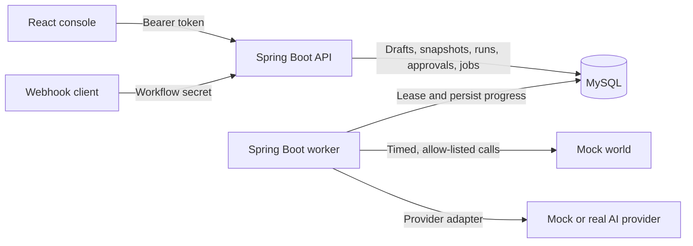
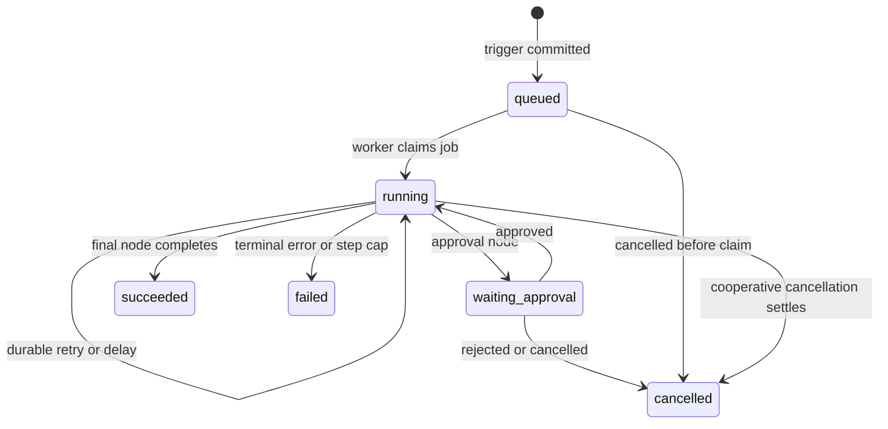

# Relay — AI Workflow Orchestrator

Relay is a durable workflow orchestration platform for operations flows that combine deterministic work, AI classification, human approval, and sensitive side effects. Workflows are defined as typed node graphs, published as immutable runnable definitions, accepted through manual or webhook triggers, and executed asynchronously by a recoverable worker. A React console shows workflows, runs, step traces and approvals, and lets an operator approve, reject or cancel.

## Highlights

- Draft → publish workflow lifecycle with immutable published definitions and per-run snapshots
- Manual and secret-protected webhook triggers
- MySQL-backed durable queue with leases, fencing, retry backoff, and restart recovery
- Typed nodes for conditions, delays, HTTP calls, notifications, mock-world order actions, AI, and approvals
- Strict AI JSON parsing and JSON Schema validation before downstream use
- Engine-enforced human approval for sensitive actions—model output cannot grant approval
- Stable per-action idempotency keys across retries and uncertain crash recovery
- Persisted run-wide step cap for bounded loops
- Redacted run traces with resolved inputs, outputs, attempts, errors and AI token usage
- Separate API and single-worker processes built from one Spring Boot application
- Local mock world, mock AI provider, four seeded workflows, and automated unit, integration and browser tests

## Current status

| Area | Status |
| --- | --- |
| Workflow drafts, validation, publication, and seed loading | Implemented and tested |
| Manual/webhook acceptance and durable execution | Implemented and tested |
| Deterministic nodes, retries, delays, and crash recovery | Implemented and tested, including live `kill -9` drills |
| AI nodes, schema enforcement, approvals, and cancellation | Implemented and tested; real provider (OpenRouter) live-verified |
| Run list/detail and redacted trace APIs | Implemented and tested |
| Console: workflows, runs, traces, approvals, cancellation | Implemented and tested (mocked and live browser suites) |
| End-to-end verification | Complete — see [docs/VERIFICATION_REPORT.md](docs/VERIFICATION_REPORT.md) |
| Delivery documentation and demo script (Phase 8) | In progress — see [PROJECT_PLAN.md](PROJECT_PLAN.md) |

## Architecture



The API owns authentication, workflow management, publication, trigger acceptance, run/trace queries, approvals, cancellation, migrations, and seed loading. The non-web worker claims committed jobs and executes one workflow step at a time. Both processes share the same database and executable JAR; `RELAY_MODE` selects their role. Only one active worker is supported.

More detail:

- [Architecture and transaction boundaries](docs/ARCHITECTURE.md)
- [Data model](docs/DATA_MODEL.md)
- [Workflow semantics](docs/WORKFLOW_SEMANTICS.md)
- [Recovery and lease protocol](docs/RECOVERY.md)
- [Console design](docs/CONSOLE.md)

## Technology

| Layer | Technology |
| --- | --- |
| Backend | Java 21, Spring Boot 4.1, Spring MVC, Spring Data JPA, Spring Security |
| Persistence | MySQL 8.4, Flyway, native SQL where queue fencing requires affected-row checks |
| Frontend | React 19, TypeScript 7, Vite 8, React Router |
| Testing | JUnit, Testcontainers, Node test runner, Playwright |
| Local services | Docker Compose (MySQL only), Python mock services |

Exact pinned versions and compatibility notes are in [docs/SETUP.md](docs/SETUP.md).

## Prerequisites

| Tool | Version | Check |
| --- | --- | --- |
| JDK | 21 (`java` and `javac` on `PATH`) | `java -version` |
| Docker with Compose | Docker Desktop or engine with the `compose` plugin, running | `docker compose version` |
| Node.js / npm | 24.21.0 / 11.19.0 (`frontend/.nvmrc`) | `node --version` |
| Python | 3.9 or newer (standard library only) | `python3 --version` |

Gradle is provided by the wrapper (`backend/gradlew`); no global install is needed. The first Gradle build and the first `docker compose up` download dependencies and the pinned MySQL image, so they need network access. Later builds can use `--offline`.

Free local ports: `3306` (MySQL), `8080` (API), `9210` (mock world), `9001` (mock AI provider), `5173` (console dev server). All bind to `127.0.0.1`. See [Troubleshooting](#troubleshooting) to change them.

All commands below run from the repository root unless noted. **The backend does not load `.env` files automatically:** export settings in each terminal before starting a process.

## Quick start

Use a separate terminal for each long-running process (API, worker, mock world, mock provider, console). The order matters: the API must migrate the database before the worker starts.

### 1. Build the backend

```sh
cd backend
./gradlew --gradle-user-home .gradle/user-home --no-daemon test bootJar
cd ..
```

This produces `backend/build/libs/relay-backend-0.1.0.jar`, used by both the API and the worker. When you rebuild later, stop the API and worker first: the build replaces the jar in place, and a running JVM can fail to load classes from the replaced file.

### 2. Create local secrets and start MySQL

```sh
python3 scripts/init_mysql_secrets.py
(umask 077; python3 -c 'import secrets; print(secrets.token_hex(32))' > local-data/demo-token)
docker compose up -d --wait --wait-timeout 180
docker compose ps
```

The initializer creates random database passwords under the ignored `local-data/mysql/` directory; re-running it keeps existing values. The second line creates a private management token in the ignored `local-data/demo-token` file; run it only once, or you replace the token. The `relay_mysql_data` volume keeps database data across ordinary `docker compose down`/`up`.

### 3. Start the API

```sh
export RELAY_DB_URL=jdbc:mysql://localhost:3306/relay
export RELAY_DB_USER=relay
export RELAY_DB_PASSWORD="$(cat local-data/mysql/password)"
export RELAY_DEMO_TOKEN="$(cat local-data/demo-token)"
RELAY_MODE=api java -jar backend/build/libs/relay-backend-0.1.0.jar
```

On startup the API applies Flyway migrations and loads the seed workflows (see [Seed loading](#seed-loading)). Check it from another terminal:

```sh
curl --max-time 5 http://127.0.0.1:8080/actuator/health/liveness
curl --max-time 5 http://127.0.0.1:8080/actuator/health/readiness
```

Both return HTTP 200 with status `UP` when the API is ready. Readiness returns 503 while the database is unreachable.

### 4. Start the mock services

```sh
python3 scripts/run_mock.py world
```

```sh
python3 scripts/run_mock.py provider
```

The mock world (`http://127.0.0.1:9210`) receives notifications and order actions and records them in an idempotency-aware ledger; it is required. The mock AI provider (`http://127.0.0.1:9001`) is the default AI target. It deliberately replies in prose, so AI workflows run against it fail with `invalid_ai_json` after one schema repair. To see successful AI branching, configure a real provider (below). Mock endpoints and fault controls are described in [docs/MOCKS.md](docs/MOCKS.md).

### 5. Start the worker

```sh
export RELAY_DB_URL=jdbc:mysql://localhost:3306/relay
export RELAY_DB_USER=relay
export RELAY_DB_PASSWORD="$(cat local-data/mysql/password)"
RELAY_MODE=worker java -jar backend/build/libs/relay-backend-0.1.0.jar
```

The worker has no HTTP port and does not need the management token. Keep exactly one worker running; stop the old one before starting another.

**Real AI provider (optional).** To use OpenRouter instead of the mock provider, create the private, ignored credential file once, then start the worker with it loaded:

```sh
python3 scripts/configure_ai.py --provider openrouter
```

```sh
set -a
source backend/.env.ai
set +a
RELAY_MODE=worker java -jar backend/build/libs/relay-backend-0.1.0.jar
```

The helper prompts for the model (for example `openai/gpt-5-mini`) and hides the key as you type it; it refuses to overwrite an existing file. Only source a file you created yourself. Mock and real provider settings, credential handling, switching providers, error codes and the explicit, potentially billable live probe (`python3 scripts/verify_live_ai.py`) are in [docs/AI_PROVIDERS.md](docs/AI_PROVIDERS.md).

### 6. Start the console

```sh
cd frontend
source ~/.nvm/nvm.sh
nvm use
npm ci
cp -n .env.example .env.local
npm run dev
```

Open [http://127.0.0.1:5173/console/workflows](http://127.0.0.1:5173/console/workflows) and paste the token from `local-data/demo-token` into **API access**. The token is kept in memory only; reloading the page asks again. The console is read-and-operate: creating, editing, publishing and triggering workflows are done through the API.

### 7. Trigger a run

In a new terminal at the repository root (the token must be exported in every shell that calls the API):

```sh
export RELAY_DEMO_TOKEN="$(cat local-data/demo-token)"
curl -i -X POST http://127.0.0.1:8080/workflows/wf_runaway/trigger \
  -H "Authorization: Bearer $RELAY_DEMO_TOKEN" \
  -H 'Content-Type: application/json' \
  --data '{"input":{"order_id":"ord_2001"}}'
```

Expect `202` with a `run_id`. `202` means accepted, not finished: the worker then runs the loop until the 12-step cap fails it with `max_steps`. Follow it in the console under **Runs**, or with `GET /runs/{runId}`. More scenarios (approval pause, automatic branch, delay cancellation, AI triage) are in [docs/CONSOLE_DEMO.md](docs/CONSOLE_DEMO.md); the full presenter walkthrough (AI branching, prompt injection, approvals, crash and resume, step cap, smoke test) is [docs/DEMO.md](docs/DEMO.md).

## Configuration

Export these in the environment of the process that uses them. Examples with comments are in [backend/.env.example](backend/.env.example), [frontend/.env.example](frontend/.env.example) and the root [.env.example](.env.example). Never put database passwords, management tokens or provider keys in `VITE_*` variables: Vite values are public browser configuration.

### Required

| Variable | Process | Purpose |
| --- | --- | --- |
| `RELAY_MODE` | API, worker | Exactly `api` or `worker` |
| `RELAY_DB_URL` | API, worker | `jdbc:mysql://host[:port]/schema`, no credentials or query parameters |
| `RELAY_DB_USER` | API, worker | Database user (`relay` with Compose) |
| `RELAY_DB_PASSWORD` | API, worker | Database password (`local-data/mysql/password` with Compose) |
| `RELAY_DEMO_TOKEN` | API | Bearer token for all management routes; HTTP token characters, no whitespace |

### Optional

| Variable | Process | Default | Purpose |
| --- | --- | --- | --- |
| `RELAY_API_PORT` | API | `8080` | API port (bound to 127.0.0.1) |
| `RELAY_ALLOWED_ORIGINS` | API | `http://localhost:5173,http://127.0.0.1:5173` | Exact comma-separated browser origins for CORS; the default covers both addresses of the dev console, whose proxy forwards the browser origin; blank disables cross-origin access |
| `RELAY_LOAD_SEEDS` | API | `true` | Insert missing seed workflows at startup; exactly `true` or `false` |
| `MOCK_WORLD_URL` | API, worker | `http://localhost:9210` | Mock-world origin for notification and order-action nodes (calls are made by the worker) |
| `RELAY_HTTP_ALLOWED_ORIGINS` | API, worker | value of `MOCK_WORLD_URL` | Exact allow-list of origins that workflow HTTP calls may reach |
| `RELAY_AI_MODE` | Worker | `mock-http` | `mock-http`, `openai` or `openrouter` |
| `RELAY_AI_BASE_URL` | Worker | `http://localhost:9001` | Mock provider origin; ignored by real providers, whose endpoints are fixed |
| `RELAY_AI_MODEL` | Worker | `alpha-small` for the mock | Model identifier; required for real providers |
| `RELAY_AI_API_KEY` | Worker | local mock token | Provider credential; required for real providers; server-side only |
| `RELAY_DB_TX_TIMEOUT_MS` | API, worker | `5000` | Database connection/transaction wait, 1000–60000 |
| `RELAY_HTTP_TIMEOUT_MS` | API, worker | `10000` | Total deadline for one workflow HTTP call |
| `RELAY_AI_TIMEOUT_MS` | API, worker | `30000` | Total deadline for one AI provider call |
| `RELAY_JOB_POLL_MS` | Worker | `250` | Idle queue poll interval |
| `RELAY_JOB_LEASE_MS` | API, worker | `60000` | Job ownership lease; a crashed worker's job is recovered after it expires |
| `RELAY_JOB_RENEW_MS` | API, worker | `10000` | Lease heartbeat interval |
| `RELAY_RETRY_MAX_ATTEMPTS` | API, worker | `3` | Attempts per step, including the first |
| `RELAY_RETRY_BASE_MS` | API, worker | `1000` | First retry delay (doubles per retry) |
| `RELAY_RETRY_MAX_MS` | API, worker | `30000` | Retry delay ceiling |

The API freezes the timeout, lease and retry settings into each run when it accepts it, so set them the same in both processes. Keep `lease > renewal + largest call timeout + 2 × DB timeout` when changing them; see [docs/RECOVERY.md](docs/RECOVERY.md).

### Docker Compose and frontend

| Variable | Used by | Default | Purpose |
| --- | --- | --- | --- |
| `RELAY_MYSQL_PORT` | Compose | `3306` | Host port for MySQL (also change the port in `RELAY_DB_URL`) |
| `RELAY_MYSQL_SECRET_DIR` | Compose | `./local-data/mysql` | Directory holding the `password` and `root-password` files |
| `VITE_RELAY_API_BASE_URL` | Frontend build | `http://localhost:8080` | Public API origin, set in `frontend/.env.local`; restart Vite after changing |
| `RELAY_E2E_API`, `RELAY_E2E_TOKEN`, `RELAY_E2E_EXPENSE_SECRET` | Live browser tests | unset | Live-stack Playwright suite; skipped when unset |

## Seed loading

On every API start (not worker start), after migrations, Relay loads the four canonical workflows from [backend/src/main/resources/catalog/seed_workflows.json](backend/src/main/resources/catalog/seed_workflows.json) as **published**:

| ID | Trigger | Scenario |
| --- | --- | --- |
| `wf_support_triage` | Webhook | AI classifies support input; refund requests require approval before the order action, while other classifications notify support |
| `wf_expense_approval` | Webhook | Deterministic amount branch; expenses above 100 wait for finance approval |
| `wf_slow_fulfillment` | Manual | Confirmation → 20-second durable delay → shipment → shipped notification; used for kill-and-resume verification |
| `wf_runaway` | Manual | Polls an order in a loop until the persisted 12-step cap fails the run |

- **Repeatable.** Only missing IDs are inserted, in one transaction. The API logs `Workflow seeds: created=N, preserved=N`: `created=4, preserved=0` on a fresh database, `created=0, preserved=4` on every later start.
- **Never overwrites.** An existing workflow with a seed ID is left alone, even if you edited it. An edited seed stays a draft after restart; its previous publication is kept. To change a seed on purpose, use the normal `PUT` and `publish` routes.
- **Disable** with `export RELAY_LOAD_SEEDS=false` before starting the API (for an intentionally empty database). This does not delete workflows that were already loaded.
- **Restore the original seeds** only by resetting the database (see [Shutdown and reset](#shutdown-and-reset)); there is no automatic reset.
- **Webhook secrets** for the two webhook seeds are fixture values (`trigger.secret`) in the seed file above. They are never returned by the API.

Seeding creates no runs, jobs or external calls. Verified on a fresh database in task 7.8 ([evidence](docs/phase7-verification.txt)).

## API overview

Management routes require `Authorization: Bearer <RELAY_DEMO_TOKEN>`. Webhooks use the workflow's `X-Relay-Secret` instead. Health probes are public. Request/response schemas, validation rules, status codes, examples and edge cases are in [API_DOCUMENTATION.md](API_DOCUMENTATION.md).

| Method | Route | Purpose |
| --- | --- | --- |
| `GET` | `/actuator/health` | Aggregate health |
| `GET` | `/actuator/health/liveness` | Process liveness |
| `GET` | `/actuator/health/readiness` | Database-backed readiness |
| `GET` / `POST` | `/workflows` | List workflows / create a draft |
| `GET` / `PUT` | `/workflows/{workflowId}` | Read / replace a draft |
| `POST` | `/workflows/{workflowId}/publish` | Validate and freeze a definition |
| `POST` | `/workflows/{workflowId}/trigger` | Accept a manual run |
| `POST` | `/hooks/{workflowId}` | Accept a secret-protected webhook run |
| `GET` | `/runs` | List runs newest first, with filters and paging |
| `GET` | `/runs/{runId}` | Run status and redacted step trace |
| `POST` | `/runs/{id}/cancel` | Cancel, or request cooperative cancellation |
| `GET` | `/approvals` | List approvals by status (default `pending`) |
| `POST` | `/approvals/{id}/approve` | Approve and asynchronously resume |
| `POST` | `/approvals/{id}/reject` | Reject and cancel the run |

## Run state model



Delay and retry jobs keep the public `running` status and store their wait reason and due time separately. Every logical node visit has a persisted sequence number, and each attempt is stored separately. Retries and worker restarts do not allocate another logical step; loop visits do. Full transition rules are in [docs/STATE_TRANSITIONS.md](docs/STATE_TRANSITIONS.md).

## Crash recovery and side-effect safety

Relay does not claim universal exactly-once delivery over HTTP. It combines durable, at-least-once execution with receiver-side idempotency:

1. The API atomically commits a run, immutable definition snapshot, frozen execution policy, and initial job before returning `202`.
2. The worker claims jobs with an owner, lease, and generation fence. External calls occur outside database transactions.
3. Before a side effect, Relay persists the resolved request and a stable key shaped as `{run_id}:{step_sequence}`.
4. Step completion and successor scheduling commit atomically and only while the worker still owns the lease.
5. If a worker dies after the receiver acted but before local completion committed, recovery marks the abandoned attempt uncertain and replays the same request with the same key.
6. The supplied mock world deduplicates that key, producing one intended effect. A receiver that ignores idempotency keys can still duplicate an effect in this crash window.

Delays and retry deadlines live in MySQL, not in sleeping worker threads. Approval waits hold no worker lease. A persisted step counter stops restarts and retries from resetting loop limits. Both crash points were verified live with `kill -9` ([verification report](docs/VERIFICATION_REPORT.md#crash-and-recovery-evidence-73-74)).

## Testing

Run every automated suite with one command from the repository root (Java 21, the Node version in `frontend/.nvmrc`, and Docker running for the MySQL stage):

```sh
python3 scripts/run_checks.py
```

It runs these stages in order: `backend` (unit tests and jar), `mysql` (real-MySQL Testcontainers suite), `frontend` (unit tests, type check and build), `browser` (mocked Chromium suite), `scripts` (every `scripts/test_*.py`) and `docs` (every document check). Before each stage it checks the prerequisites; a missing one fails that stage with a hint instead of skipping it. Gradle test tasks always re-execute (`--rerun`), so cached results are never reported. A summary table lists each stage's status, test counts and log (`tmp/checks/<stage>.log`). The exit status is 0 only when no stage failed. Options:

| Option | Effect |
| --- | --- |
| `--skip STAGE` | Leave a stage out, for example `--skip mysql` without Docker; the summary reports it as not run |
| `--only STAGE` | Run only the named stages (repeatable) |
| `--install` | Fresh clone: run `npm ci` and create `frontend/.env.local` from `frontend/.env.example` if it is missing (never overwritten) before the frontend stage |
| `--offline` | Pass `--offline` to Gradle once dependencies are cached |

On a fresh clone, run `python3 scripts/run_checks.py --install` once; Gradle and npm need network access the first time, and the browser stage needs `npx playwright install chromium` (from `frontend/`). The individual commands follow.

Backend unit tests and executable JAR (no Docker needed):

```sh
cd backend
./gradlew --gradle-user-home .gradle/user-home --no-daemon --offline test bootJar
```

Backend integration suite with disposable MySQL containers (Docker must be running; it never touches your `relay` database):

```sh
cd backend
./gradlew --gradle-user-home .gradle/user-home --no-daemon --offline test bootJar testcontainersTest
```

Frontend unit tests, type check and build, and mocked browser tests (from `frontend/`, after `nvm use`):

```sh
npm test
npm run build
npx playwright install chromium
npm run test:browser
```

The live browser suite, the end-to-end verification drivers and the real-provider probe run against a live stack; commands are in [docs/VERIFICATION_REPORT.md](docs/VERIFICATION_REPORT.md#reproducing) and [docs/CONSOLE_DEMO.md](docs/CONSOLE_DEMO.md). The real-provider probe is explicit, synthetic and potentially billable, and is never part of the normal test tasks. The latest full run (task 8.8, after the Phase 8 fixes) is recorded in the verification report: 371 automated tests, 0 failures.

## Shutdown and reset

Stop the console, worker, API and mocks with `Ctrl-C` in their terminals. Then stop MySQL, keeping its data:

```sh
docker compose down
```

Start again with `docker compose up -d --wait --wait-timeout 180` and the API/worker commands above; runs, approvals and workflows are preserved, and an interrupted run resumes when the worker starts.

**Destructive reset** (deletes every workflow, run and approval in the local database). Stop the API and worker first, then:

```sh
docker compose down --volumes
docker compose up -d --wait --wait-timeout 180
```

The secret files and token are kept, so the same credentials initialize the new empty database. Start the API to migrate it and reload the seeds, then the worker. The mock world keeps its ledger in memory: restarting `run_mock.py world`, or `curl -X POST http://127.0.0.1:9210/admin/reset -H 'Content-Type: application/json' -d '{}'`, clears it (and erases that evidence). Do not use `docker volume prune` or `docker system prune` as a reset.

## Troubleshooting

| Symptom | Cause and fix |
| --- | --- |
| Worker exits with `start the matching API migrations first` | The database has not been migrated. Start the API first, wait for readiness `UP`, then start the worker. |
| Startup fails with `RELAY_MODE must be exactly api or worker` | `RELAY_MODE` is missing or misspelled. Set it to `api` or `worker`; Spring profiles are not used for this. |
| Startup fails with `must be nonempty` | A required variable (named in the message) is not exported in this terminal. The backend does not read `.env` files; export the [required variables](#required). |
| API fails with `RELAY_LOAD_SEEDS must be true or false` | Only lowercase `true` or `false` is accepted. |
| API fails with `RELAY_DEMO_TOKEN must use HTTP bearer-token characters without whitespace` | Use a token like the generated hex token; check for a trailing space or newline. |
| `java: command not found`, or the JAR fails with an unsupported class version | JDK 21 is not first on `PATH`. Set `JAVA_HOME` to a JDK 21 and put its `bin` on `PATH`; check with `java -version`. |
| `docker compose up` fails, or MySQL stays unhealthy | Docker is not running, secrets are missing, or port 3306 is taken. Run `python3 scripts/init_mysql_secrets.py`, check `docker compose logs --tail 100 mysql`, or set `RELAY_MYSQL_PORT=3307` and use port 3307 in `RELAY_DB_URL`. If you edited a password file after the database was created, restore it: changing the file does not change the database account. |
| API or worker cannot connect to the database | MySQL is not healthy, or `RELAY_DB_PASSWORD`/port does not match. Check `docker compose ps`, then re-export `RELAY_DB_PASSWORD="$(cat local-data/mysql/password)"`. |
| Port 8080, 9210, 9001 or 5173 already in use | Stop the other process, or change the port: `RELAY_API_PORT` (then update `VITE_RELAY_API_BASE_URL` and restart Vite); `run_mock.py world --port N` with `MOCK_WORLD_URL` and `RELAY_HTTP_ALLOWED_ORIGINS`; `run_mock.py provider --port N` with `RELAY_AI_BASE_URL`. The Vite server does not switch ports on its own. The seed workflows' own mock addresses assume 9210. |
| API returns `401` with `unauthorized`, or the console rejects the token | Missing or wrong bearer token. Use the exact `RELAY_DEMO_TOKEN` the API was started with; restart the API after changing it. |
| Webhook returns `401` with `invalid_webhook_secret` | The `X-Relay-Secret` header does not match the workflow's `trigger.secret`. No run is created. |
| Console shows "Access denied" when you approve, reject or cancel | The console's address is not in `RELAY_ALLOWED_ORIGINS` (the dev proxy forwards the browser origin on changes). Open the console at `http://127.0.0.1:5173` or `http://localhost:5173`, or add its exact origin and restart the API. |
| Console shows a network error | The API is not running at `VITE_RELAY_API_BASE_URL`, or its browser origin is not in `RELAY_ALLOWED_ORIGINS` (browsers report CORS denials as network errors). `npm run preview` needs `http://127.0.0.1:4173` added. |
| No seed workflows listed | The API was started with `RELAY_LOAD_SEEDS=false`, or you are pointing at another database. Check the API log for `Workflow seeds: created=`. |
| An edited seed workflow is still a draft after restart | By design, seeding never overwrites. Publish it with `POST /workflows/{id}/publish`, or reset the database to restore the originals. |
| AI step fails with `invalid_ai_json` | Expected with the supplied mock provider, which replies in prose. Configure a real provider to see AI branching. |
| Steps fail with `transport_failure` then `retry_exhausted` | The mock world is not running on `MOCK_WORLD_URL`. Start `python3 scripts/run_mock.py world`, then trigger a new run. |
| Step fails with `destination_denied` | The HTTP destination is not in `RELAY_HTTP_ALLOWED_ORIGINS`. Add its exact origin to the worker environment and restart the worker. |
| AI step fails with `ai_provider_configuration_changed` | The provider or model changed while a request was prepared. Start a new run with the new configuration. |
| Run stays `running` for about a minute after a worker crash | Expected: the replacement worker waits for the crashed worker's lease (`RELAY_JOB_LEASE_MS`, default 60 s) to expire, then recovers the job. |
| Worker exits with `Worker dispatch loop stopped unexpectedly` | The worker hit an unrecoverable error (for example, the jar was rebuilt while it was running) and exited on purpose instead of staying alive and idle. Restart it; unfinished work is recovered after the lease (default 60 s). Stop the API and worker before rebuilding. |
| Run stays `queued` | No worker is running, or it is using a different database. Start one worker with the same `RELAY_DB_*` settings as the API. |
| `testcontainersTest` fails immediately | Docker is not running. Start Docker and rerun; there is no silent skip. |
| Gradle `--offline` fails on a new machine | Dependencies are not cached yet. Run the same command once without `--offline`. |
| npm ci warns that fsevents has install scripts not covered by allowScripts | Harmless on macOS: the package ships a prebuilt binary, and `npm ci` still exits 0. No action needed. |
| API call returns `401` right after starting the stack | The calling terminal has no token. Run `export RELAY_DEMO_TOKEN="$(cat local-data/demo-token)"` in that terminal first. |
| `npm run dev` or `npm run build` fails on configuration | `frontend/.env.local` is missing or `VITE_RELAY_API_BASE_URL` is not a plain `http(s)://host:port` origin. Copy `frontend/.env.example`. |

More detail on each component is in [docs/SETUP.md](docs/SETUP.md).

## Known limitations

- **One active worker.** Multiple concurrent workers are outside scope. Recovery after a crash during a call waits for the 60-second lease.
- **Exactly-once depends on the receiver.** Effects are at-least-once with stable idempotency keys. The mock world deduplicates them; a receiver that ignores `Idempotency-Key` may see a resend after an uncertain outcome.
- **Timeouts are ambiguous.** A timed-out side-effecting call may still have executed on the receiver; this is recorded, not hidden. Real-provider retries after a timeout may be billed twice.
- **Mock AI provider replies in prose,** so AI-success paths need a real provider. AI classifications were verified on single live samples, not as an accuracy measurement; safety does not depend on them.
- **Single management token.** One bearer token grants all management actions; there are no user accounts, TLS or production deployment.
- **Console is read-and-operate.** Create, edit, publish and trigger go through the API; there is no graphical builder.
- **Out of scope:** schedules/cron triggers, parallel branches, sub-workflows, numbered version history, replay of failed steps, the natural-language workflow compiler, multi-tenancy.

The full list with evidence is in [docs/VERIFICATION_REPORT.md](docs/VERIFICATION_REPORT.md#known-limitations).

## Project layout

```text
.
├── backend/                 Spring Boot API, worker, migrations, catalog, tests
├── frontend/                React/Vite console, unit and browser tests
├── scripts/                 Setup, mocks, AI configuration, verification drivers, document checks
├── docs/                    Design documents, verification report and evidence
├── compose.yaml             Local MySQL service
├── API_DOCUMENTATION.md     Implemented API contract
└── PROJECT_PLAN.md          Ordered roadmap, task records, and completion log
```

## Documentation

- [Requirements traceability](docs/REQUIREMENTS.md)
- [MVP and scope](docs/MVP.md)
- [API reference](API_DOCUMENTATION.md)
- [Architecture](docs/ARCHITECTURE.md)
- [Data model](docs/DATA_MODEL.md)
- [State transitions](docs/STATE_TRANSITIONS.md)
- [Workflow semantics](docs/WORKFLOW_SEMANTICS.md)
- [Recovery design](docs/RECOVERY.md)
- [Local setup details](docs/SETUP.md)
- [Mock services](docs/MOCKS.md)
- [AI provider configuration](docs/AI_PROVIDERS.md)
- [Console demo](docs/CONSOLE_DEMO.md)
- [Demo script](docs/DEMO.md)
- [Verification report](docs/VERIFICATION_REPORT.md)
- [Manual publication guide](docs/PUBLICATION.md)
- [Roadmap and completion log](PROJECT_PLAN.md)

## Publication

All work is kept local. The project is never pushed or published by automated tooling; creating a remote repository and uploading the project is a manual step for the owner.

Before publishing, run the pre-publication check from the repository root. It confirms that no credential is in the files or the git history (comparing the real local secret values without printing them), that `.env*`, `local-data/` and build output are ignored and were never committed, and that no file needed to run contains a machine-specific path:

```sh
python3 scripts/check_no_secrets.py
```

The full step-by-step owner checklist (checks, the pack licence decision, updating `main`, repository visibility and what to record afterwards) is in the [manual publication guide](docs/PUBLICATION.md).
